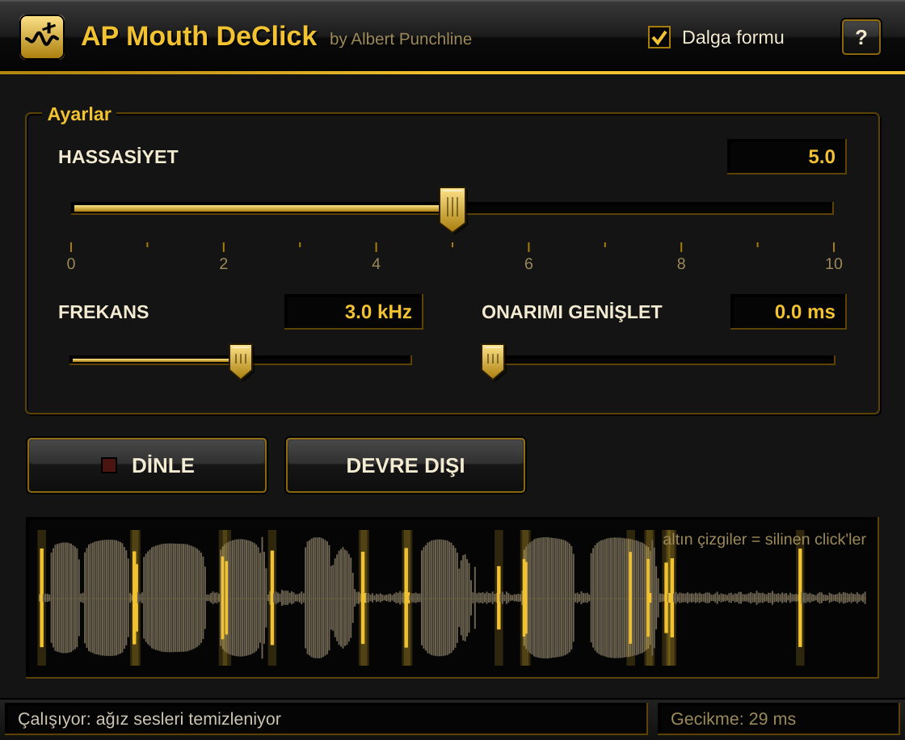

# AP Mouth DeClick
**Albert Punchline Mouth DeClick**

Vokal kayıtlarındaki ağız seslerini (dil şaklaması, dudak/tükürük "tık"ları) otomatik bulup temizleyen VST3 / AU plugin'i. FL Studio ve diğer DAW'larda çalışır.



## Kontroller

| Kontrol | Ne yapar |
|---|---|
| **Hassasiyet** (0–10, varsayılan 5) | Bir sesin click sayılması için ne kadar keskin olması gerektiği. Click'ler gidene kadar artır; "s" ve "t" sesleri körelmeye başlarsa azalt. 0 = işlem yok. |
| **Frekans** (1–8 kHz, varsayılan 3 kHz) | Click'lerin arandığı bölge. Bunun altındaki her şey (sesin gövdesi) onarım sırasında olduğu gibi korunur. Daha boğuk ağız seslerini yakalamak için düşür. |
| **Onarımı Genişlet** (0–5 ms) | Her onarımı iki yönde de genişletir. Onarımdan sonra hafif bir "tık" kalıyorsa kullan. |
| **Dinle** | Sadece silinen sesi çalar. Kelime değil, sadece click duymalısın; kelime duyuyorsan Hassasiyet fazla yüksek. |
| **Devre Dışı** | Orijinal sesi çalar (gecikme korunur, karşılaştırma temiz olur). DAW'ın bypass tuşu da buna bağlıdır. |
| **Dalga formu** | Son ~4 saniyeyi gösterir; altın çizgiler silinen click'ler. |

Slider'a çift tıklarsan varsayılan değerine döner. Gecikme ~29 ms; DAW'a bildirilir, FL Studio otomatik telafi eder.

## Nasıl çalışıyor

1. **Tespit:** Ses Frekans değerinden yukarısı için filtrelenir. Çok hızlı (0.2 ms) ve yavaş (20 ms) iki enerji takipçisi karşılaştırılır. Click, arka plandan aniden fırlayan kısa bir patlamadır. 4 ms'den uzun olaylar (sessiz harfler, "s", "t") click sayılmaz.
2. **Onarım:** Click bölgesi, öncesindeki ve sonrasındaki sesten tahmin edilerek (Burg LPC / otoregresif interpolasyon) yeniden oluşturulur. Vokal varken sadece Frekans üstündeki bant yeniden yapılır, gövde olduğu gibi kalır. Sessizlikte tam bant onarılır.

## Derleme

### En kolay yol: GitHub (hiçbir şey kurmadan)
1. GitHub'da yeni bir repo aç ve bu klasördeki her şeyi yükle (`.github` klasörü dahil).
2. **Actions** sekmesinde "Build AP Mouth DeClick" kendiliğinden çalışır (~10 dk).
3. Bitince sayfanın altındaki **Artifacts** bölümünden `AP-Mouth-DeClick-VST3-Windows` (veya macOS) dosyasını indir.

### Kendi bilgisayarında
**Windows:** Visual Studio 2022 (C++ ile masaüstü geliştirme) + CMake kur, sonra bu klasörde:
```
cmake -B build
cmake --build build --config Release
```
**macOS:** Xcode + CMake ile aynı komutlar.

Çıktı: `build/APMouthDeClick_artefacts/Release/VST3/AP Mouth DeClick.vst3`

### FL Studio'ya ekleme
1. `AP Mouth DeClick.vst3` klasörünü şuraya kopyala:
   - Windows: `C:\Program Files\Common Files\VST3\`
   - macOS: `/Library/Audio/Plug-Ins/VST3/` (AU için: `/Library/Audio/Plug-Ins/Components/`)
2. FL Studio → Options → Manage plugins → **Find plugins**.
3. Mixer'da vokal kanalına ekle. EQ ve kompresörden **önce**, zincirin en başına koy.

## Kullanım ipucu
Varsayılanlarla başla, **Dinle**'yi aç ve vokali çal. Sadece tık sesleri duyana kadar Hassasiyet'i ayarla, sonra Dinle'yi kapat.
